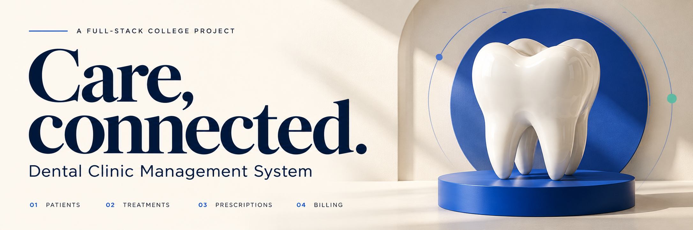
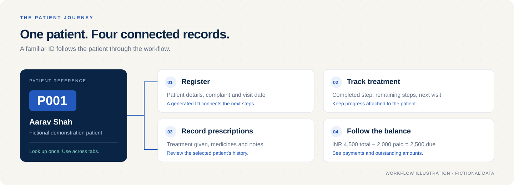
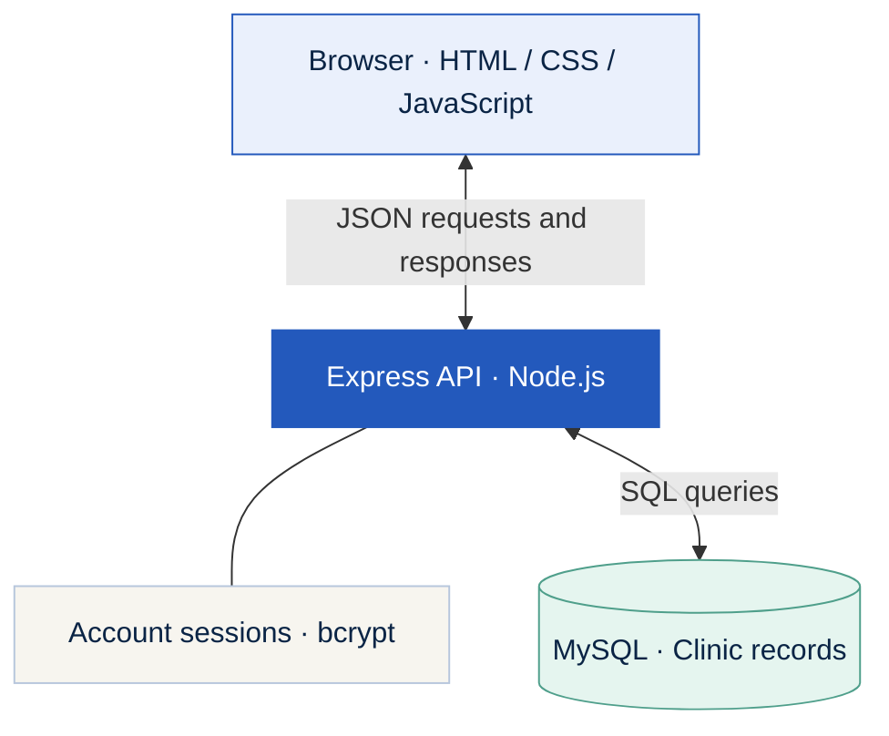

<div align="center">



<a id="-dental-clinic-management-system"></a>

# Dental Clinic Management System

**From the first visit to the remaining balance — keep the record connected.**

A full-stack college project that brings patient registration, treatment progress,<br />
prescriptions and billing into one straightforward clinic workflow.


<a href="#project">The project</a> &nbsp; / &nbsp;
<a href="#screens">Screen tour</a> &nbsp; / &nbsp;
<a href="#start">Run locally</a> &nbsp; / &nbsp;
<a href="#architecture">Architecture</a> &nbsp; / &nbsp;
<a href="docs/DEMO_WALKTHROUGH.md">Presentation guide ↗</a>

</div>

<br />

<table>
  <tr>
    <td width="33%" align="center"><h3>7</h3><b>Application screens</b><br /><sub>From sign-in to consolidated records</sub></td>
    <td width="34%" align="center"><h3>3</h3><b>Patient service tabs</b><br /><sub>Treatment · Prescription · Billing</sub></td>
    <td width="33%" align="center"><h3>1</h3><b>Shared patient reference</b><br /><sub>A patient ID used across the workflow</sub></td>
  </tr>
</table>

<a id="project"></a>

## 01 / A small system for a connected clinic

A patient arrives with a complaint. A treatment takes several visits. A prescription needs to stay with the right record. A payment may cover only part of the bill.

This project brings those details together. A doctor signs in, registers a patient and uses a generated **Universal Patient ID**, such as `P001`, to find that patient across the application. The **Patient Service Center** puts treatment, prescription and billing forms behind one shared lookup; **Patient Records** brings their information back together.

The stack stays approachable: **plain HTML, CSS and JavaScript**, an **Express API**, and **MySQL** for persistence. Separate pages and readable functions make the implementation easy to follow during a project review.

<div align="center">

<a href="assets/screenshots/02-dashboard.jpg"></a>

<sub><b>THE RUNNING APPLICATION</b> · Dashboard data is loaded from MySQL.</sub><br />
<sub>All patient details in these screenshots are fictional and were created in a separate demo database.</sub>

</div>

## 02 / Follow the patient, not the paperwork



The ID is the common reference. Look up a patient, switch between service tabs and review their history without repeatedly entering their identity. The records page then provides a wider view of patient details, care and payments.

<a id="screens"></a>

## 03 / Inside the application

**Nine actual screenshots. One connected workflow.** Select an image to inspect it at full size.

<table>
  <tr>
    <td width="50%" valign="top">
      <sub>ACCESS &amp; IDENTITY</sub>
      <h3>A clinic account to begin.</h3>
      <a href="assets/screenshots/01-login.jpg"></a>
      <p>Create an account, sign in and access its clinic records through a server-side session.</p>
    </td>
    <td width="50%" valign="top">
      <sub>PATIENT REGISTRATION</sub>
      <h3>Every record starts here.</h3>
      <a href="assets/screenshots/03-registration.jpg"></a>
      <p>Capture patient details, a visit date and the chief complaint. A patient ID is generated after saving.</p>
    </td>
  </tr>
  <tr>
    <td valign="top">
      <sub>TREATMENT PROGRESS</sub>
      <h3>Know the next step.</h3>
      <a href="assets/screenshots/04-treatment.jpg"></a>
      <p>Record the completed step, remaining steps and next appointment date against the selected patient.</p>
    </td>
    <td valign="top">
      <sub>PRESCRIPTIONS</sub>
      <h3>Keep the details together.</h3>
      <a href="assets/screenshots/05-prescription.jpg"></a>
      <p>Save treatment details, medicines, prescription dates and notes in the same patient workflow.</p>
    </td>
  </tr>
  <tr>
    <td valign="top">
      <sub>BILLING &amp; PAYMENTS</sub>
      <h3>Make the balance clear.</h3>
      <a href="assets/screenshots/06-billing.jpg"></a>
      <p>Enter charges and payments in rupees, calculate the remaining amount and review payment history.</p>
    </td>
    <td valign="top">
      <sub>CONSOLIDATED RECORDS</sub>
      <h3>See the connected picture.</h3>
      <a href="assets/screenshots/07-records.jpg"></a>
      <p>Browse patient details alongside treatment, prescription, billing and follow-up information.</p>
    </td>
  </tr>
  <tr>
    <td valign="top">
      <sub>PATIENT SEARCH</sub>
      <h3>Find the right record.</h3>
      <a href="assets/screenshots/08-search.jpg"></a>
      <p>Search by patient ID, name, mobile number or visit date, then open the matching patient's details.</p>
    </td>
    <td valign="top">
      <sub>RECORD EDITING</sub>
      <h3>Keep the information current.</h3>
      <a href="assets/screenshots/09-edit.jpg"></a>
      <p>Load a patient's existing details and related clinical records into the editing screen.</p>
    </td>
  </tr>
</table>

## 04 / What the project brings together

| Area | Implemented capability |
| :--- | :--- |
| **Clinic overview** | Database-backed counts for total patients, today's patients and ongoing treatments. |
| **Account access** | Registration, bcrypt password hashing, session-based login and logout. |
| **Patient records** | Registration, generated IDs, search, detail viewing and editing. |
| **Clinical workflow** | Shared patient lookup with treatment, prescription and billing tabs. |
| **Care history** | Treatment steps, appointment dates, prescription notes and stored payment records. |
| **Financial tracking** | Total charges, amounts paid, remaining balances and payment status. |
| **Optional connections** | Email reminders and reports, Fast2SMS reminders and Google Sheets export using your own configuration. |

<details>
<summary><b>A note on the current version</b></summary>

Treatment, prescription and billing entry now share `patient-service.html`. Earlier explanatory `.txt` files are preserved in [`docs/code-notes/`](docs/code-notes/); they describe selected snippets from an older layout and are not the runnable application.

The application stores appointment dates, rather than a calendar of exact time slots. Optional provider integrations are separate from the core local workflow and need the user's own accounts and settings.

</details>

<a id="start"></a>

## 05 / Run it on your machine

**You need:** Node.js **24+**, **MySQL 8**, and a browser. MySQL Workbench is a convenient way to run the setup SQL.

**① Get the project**

```bash
git clone https://github.com/yugsuthar208/dentist-projectt.git
cd dentist-projectt
npm ci
```

**② Create the database**

Open [`database_setup.sql`](database_setup.sql) in MySQL Workbench and execute it. It creates the `dental_clinic` database and the five core tables. The server creates the reminder log and adds missing compatibility columns on startup.

**③ Add your local settings**

Copy [`.env.example`](.env.example) to `.env` and enter your own MySQL credentials:

```dotenv
DB_HOST=localhost
DB_USER=root
DB_PASSWORD=your_mysql_password
DB_NAME=dental_clinic
```

**④ Start the clinic**

```bash
npm start
```

Open **[localhost:3000/login.html](http://localhost:3000/login.html)** → choose **Sign Up** → create an account → log in → add your first patient.

> The `.env` file is ignored by Git. New accounts start empty; the screenshot data is not bundled into your database. Email and SMS are disabled by default.

<details>
<summary><b>Configure the optional integrations</b></summary>

| Integration | Configuration |
| :--- | :--- |
| Email | Set `EMAIL_ENABLED=true`, `SMTP_USER` and `SMTP_PASSWORD` in `.env`. |
| SMS | Set `SMS_ENABLED=true` and `FAST2SMS_API_KEY` in `.env`. |
| Google Sheets | Deploy your own compatible Apps Script receiver and set `SCRIPT_URL` in `script.js`. |

Use your own sender credentials, provider accounts and export endpoint. These services may need app passwords, provider approval or credits. The reminder scheduler checks every 30 minutes using the application's date-based appointment logic.

See the **[complete setup guide](docs/SETUP.md)** for configuration fields, export payloads, database migration and troubleshooting.

</details>

<a id="architecture"></a>

## 06 / Simple layers, clear responsibilities



The browser collects form input and sends JSON requests. Express checks the session, runs MySQL queries and returns the result. `user_id` associates records with the signed-in account; `patient_id` links clinical records to the selected patient.

<details>
<summary><b>Explore the database and optional services</b></summary>

| Table | Responsibility |
| :--- | :--- |
| `users` | Account identity and hashed passwords |
| `patients` | Patient identity, contact details, complaint and visit date |
| `treatments` | Progress, remaining steps and the next appointment date |
| `prescriptions` | Treatment given, medicines, notes and date |
| `bills` | Charges, payments and balances |
| `notifications_sent` | Reminder delivery log |

The supplied schema declares `user_id` foreign keys on the main record tables. Clinical patient references are application-level associations; the schema does not declare patient foreign keys for those fields.

`node-cron` schedules reminder checks, `nodemailer` handles configured email delivery, and Fast2SMS handles configured SMS delivery. Google Sheets export runs from the browser through a separately deployed Apps Script endpoint.

</details>

<details>
<summary><b>Browse the source map</b></summary>

```text
dentist-projectt/
├── server.js                  Express routes, sessions, SQL and reminders
├── script.js                  Shared browser functions and API calls
├── style.css                  Application styling
├── login.html                 Sign-up and login
├── index.html                 Dashboard
├── add-patient.html            Registration and generated patient ID
├── search-patient.html         Patient search
├── edit-patient.html           Patient and clinical record editing
├── patient-service.html        Treatment / Prescription / Billing
├── patients-records.html       Consolidated records
├── database_setup.sql         Fresh database schema
├── migrate.sql                Compatibility migration
├── notification-config.js     Optional provider settings
├── .env.example               Private configuration template
├── package.json               Dependencies and start command
├── package-lock.json          Locked dependency versions
├── assets/                    Cover artwork, diagrams and screenshots
└── docs/                      Setup, project guide and demonstration
```

</details>

## 07 / Ready for a closer look

| Start here | What you will find |
| :--- | :--- |
| **[Presentation walkthrough →](docs/DEMO_WALKTHROUGH.md)** | A suggested six-minute demonstration, one sample patient journey and questions for discussion. |
| **[Project guide →](docs/PROJECT_GUIDE.md)** | Page responsibilities, database model, request flow, API groups and verification results. |
| **[Setup guide →](docs/SETUP.md)** | Installation, environment settings, optional integrations and troubleshooting. |
| **[Earlier learning notes →](docs/code-notes/)** | Preserved explanations from the earlier version. |

**Verification snapshot · 24 October 2026**<br />
The application was run with Node.js 24.11.0 and a separate MySQL database. Account access, patient creation, treatment, prescriptions, billing and retrieval were checked. Browser checks covered patient search, record loading and service tabs. The demo dashboard showed **6 patients · 6 visits today · 3 ongoing treatments**. [Read the detailed results](docs/PROJECT_GUIDE.md#verification-performed).

Email/SMS delivery and Sheets export were not exercised. This is a local college demonstration, with further work needed before use with real clinic data.

---

<div align="center">

### Patient details. Treatment progress. One connected workflow.

A college project by **[Yug Suthar](https://github.com/yugsuthar208)**

<a href="#project">Back to the project ↑</a>

</div>
