<div align="center">

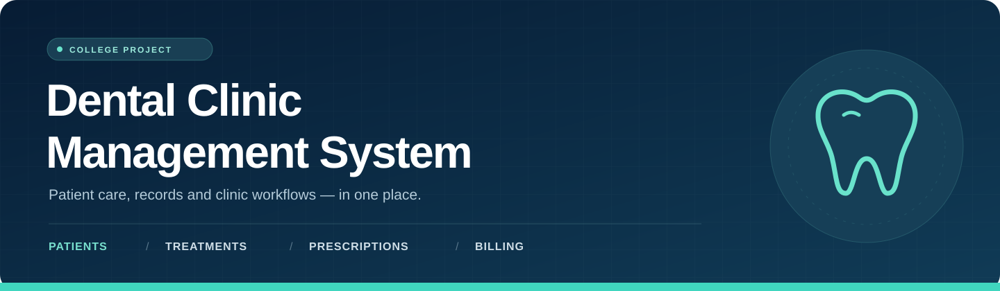

# 🦷 Dental Clinic Management System

**A simple clinic workflow. A complete patient record.**

A full-stack college project for managing patients, dental treatments,<br />
prescriptions, appointments and billing through one browser-based application.


[Overview](#-overview) · [Screenshots](#-application-tour) · [Features](#-features) · [Run locally](#-run-locally) · [How it works](#-how-it-works)

</div>

---

## ✨ Overview

A dental visit involves more than a single appointment. Patient details, treatment progress, medicines and payments all need to stay connected. This project brings those everyday tasks into a small, easy-to-follow web application.

After signing in, a doctor can register a patient, find them using a generated **Universal Patient ID** such as `P001`, and manage their care through the **Patient Service Center**. A shared records view brings patient information, treatment, prescriptions and balances together.

The implementation uses **plain HTML, CSS and JavaScript**, an **Express backend**, and a **MySQL database**. Separate pages, readable functions and direct SQL queries keep the project approachable for learning and demonstration.

<div align="center">

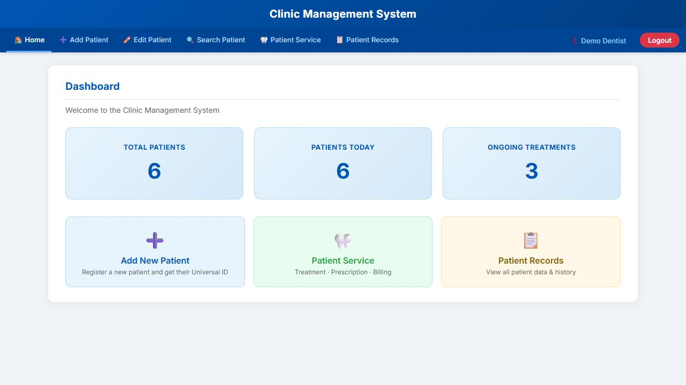

<sub><b>The running application.</b> Dashboard counts are loaded from MySQL. All records shown in this README are fictional demonstration data.</sub>

</div>

## 📸 Application tour

Click any image to view it at full size. These screenshots were captured from the current application running locally with a separate demo database.

<table>
  <tr>
    <td width="50%" valign="top">
      <h3>01 · Account access</h3>
      <a href="assets/screenshots/01-login.jpg">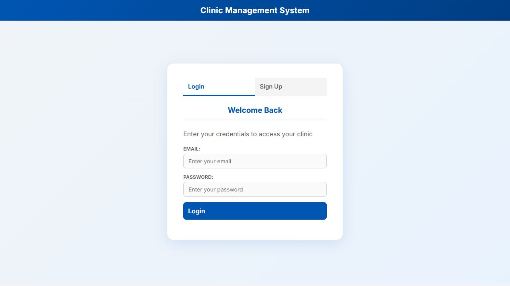</a>
      <p>Sign up, log in and access the clinic through a session-based account.</p>
    </td>
    <td width="50%" valign="top">
      <h3>02 · Patient registration</h3>
      <a href="assets/screenshots/03-registration.jpg">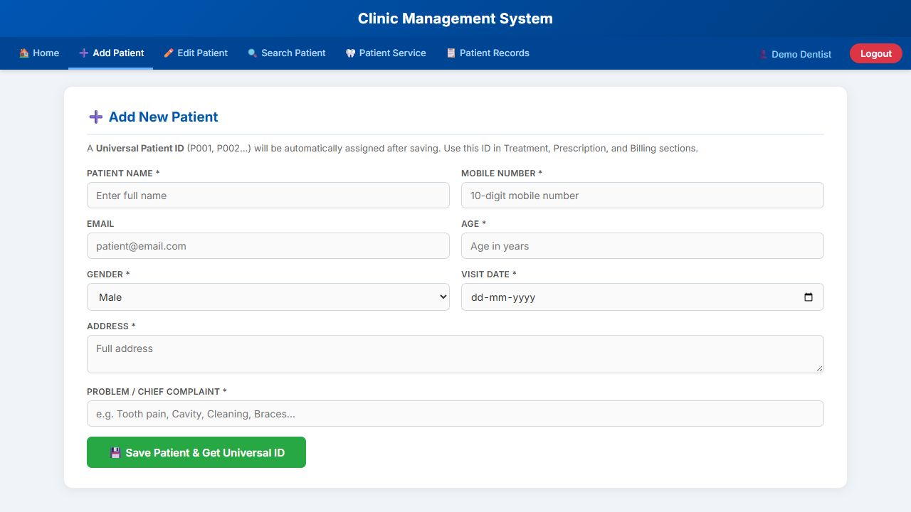</a>
      <p>Capture contact details, age, visit date and the chief complaint. Receive a generated patient ID after saving.</p>
    </td>
  </tr>
  <tr>
    <td valign="top">
      <h3>03 · Treatment progress</h3>
      <a href="assets/screenshots/04-treatment.jpg">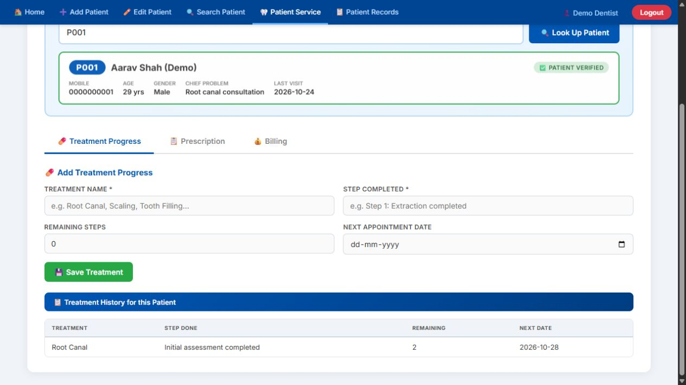</a>
      <p>Look up a patient once, record completed steps and plan the next appointment.</p>
    </td>
    <td valign="top">
      <h3>04 · Prescriptions</h3>
      <a href="assets/screenshots/05-prescription.jpg">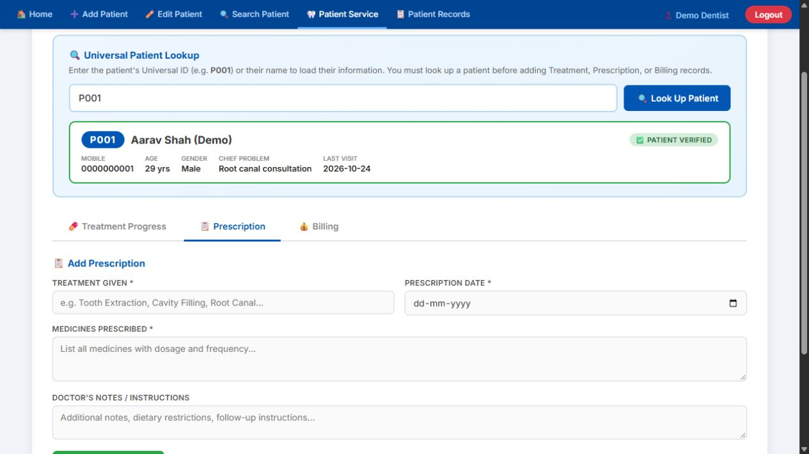</a>
      <p>Save the treatment given, medicines, date and doctor's notes against the selected patient.</p>
    </td>
  </tr>
  <tr>
    <td valign="top">
      <h3>05 · Billing &amp; payments</h3>
      <a href="assets/screenshots/06-billing.jpg">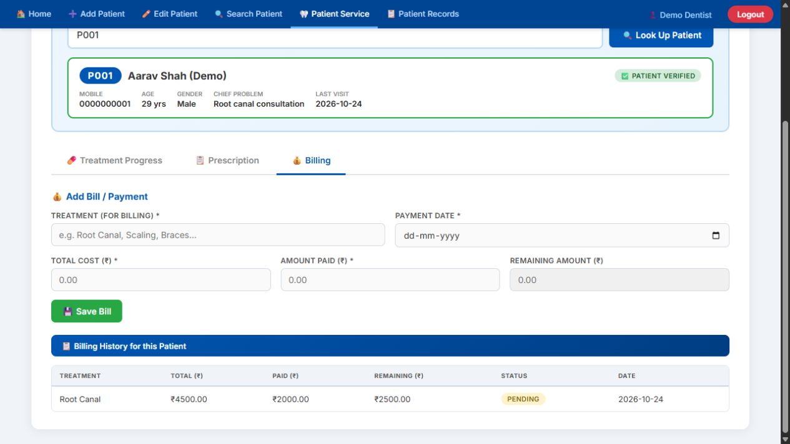</a>
      <p>Track charges and payments in rupees, calculate the remaining balance and view payment history.</p>
    </td>
    <td valign="top">
      <h3>06 · Consolidated records</h3>
      <a href="assets/screenshots/07-records.jpg">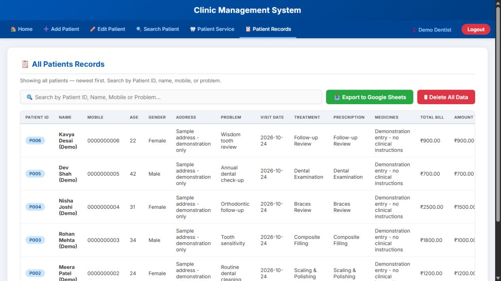</a>
      <p>Review patient information alongside treatment, prescriptions, billing and follow-up details.</p>
    </td>
  </tr>
  <tr>
    <td valign="top">
      <h3>07 · Patient search</h3>
      <a href="assets/screenshots/08-search.jpg">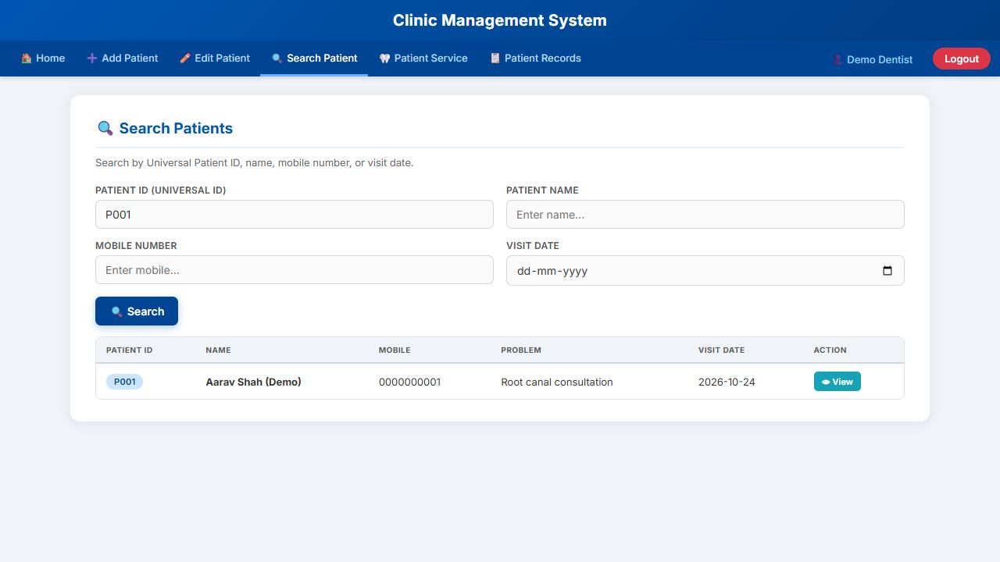</a>
      <p>Find patients by ID, name, mobile number or visit date and open their details.</p>
    </td>
    <td valign="top">
      <h3>08 · Record editing</h3>
      <a href="assets/screenshots/09-edit.jpg">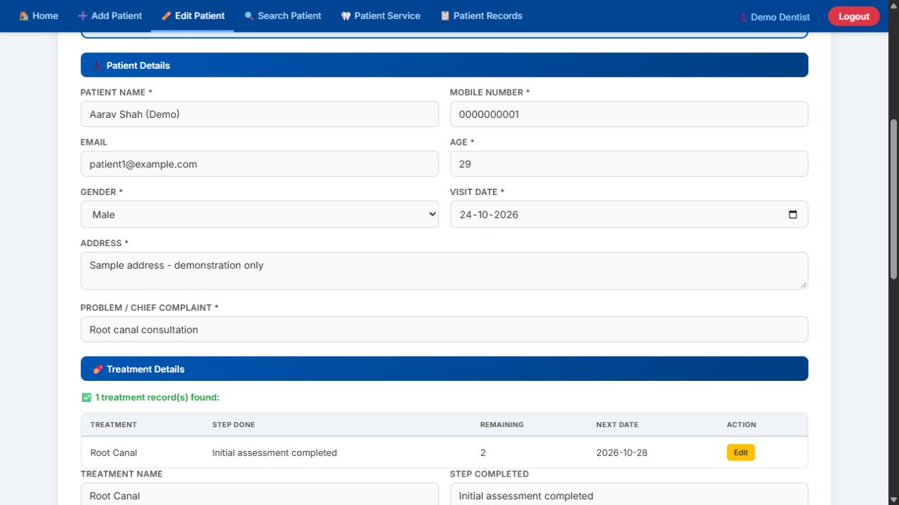</a>
      <p>Find an existing patient and load their patient, treatment, prescription and billing details for editing.</p>
    </td>
  </tr>
</table>

## 🧩 Features

| Module | What it does |
| :--- | :--- |
| **Dashboard** | Shows total patients, patients visiting today and ongoing treatments. |
| **Accounts** | Supports registration, bcrypt password hashing, login and logout with server-side sessions. |
| **Patient management** | Registers patients, generates patient IDs, searches records and edits existing details. |
| **Patient Service Center** | Places treatment, prescription and billing tabs behind a shared patient lookup. |
| **Treatment tracking** | Saves treatment names, completed steps, remaining steps and next appointment dates. |
| **Prescriptions** | Stores medicines, treatment details, notes and prescription dates. |
| **Billing** | Stores total charges and amounts paid, calculates balances and displays payment status. |
| **Patient records** | Combines clinic records in a searchable table with horizontal scrolling. |
| **Optional integrations** | Includes email reminders, Fast2SMS reminders, email reports and Google Sheets export. Requires the user's own configuration. |

> **Current version:** treatment, prescription and billing entry share `patient-service.html`. The older standalone-page explanations are preserved in [`docs/code-notes/`](docs/code-notes/) as historical learning notes.

## 🚀 Run locally

### 1. Prerequisites

- **Node.js 24 or newer**, with npm.
- **MySQL 8**, running locally.
- A browser and a MySQL client such as **MySQL Workbench**.

### 2. Clone and install

```bash
git clone https://github.com/yugsuthar208/dentist-projectt.git
cd dentist-projectt
npm ci
```

### 3. Create the database

Open [`database_setup.sql`](database_setup.sql) in MySQL Workbench and execute it. It creates the `dental_clinic` database and its five core tables.

Alternatively, from the MySQL command-line client, run the following using your checkout's absolute path:

```sql
SOURCE /absolute/path/to/dentist-projectt/database_setup.sql;
```

The server creates the reminder log table and adds missing compatibility columns when it connects. [`migrate.sql`](migrate.sql) is available for older databases; it is not required for a fresh installation.

### 4. Configure your connection

Copy [`.env.example`](.env.example) to a new file named `.env` in the project folder.

```dotenv
DB_HOST=localhost
DB_USER=root
DB_PASSWORD=your_mysql_password
DB_NAME=dental_clinic
```

Set `DB_PASSWORD` to your own local MySQL password. The `.env` file is ignored by Git. Optional email and SMS integrations are disabled by default.

### 5. Start the application

```bash
npm start
```

Open **[http://localhost:3000/login.html](http://localhost:3000/login.html)**, choose **Sign Up**, create an account and log in. A new account starts with no patients; the screenshot records are not bundled into the database.

<details>
<summary><b>Optional: email, SMS and Google Sheets</b></summary>

For email reminders and reports, set `EMAIL_ENABLED=true`, `SMTP_USER` and `SMTP_PASSWORD` in `.env`. The default service is Gmail; use your own app password where required by your provider.

For SMS reminders, set `SMS_ENABLED=true` and `FAST2SMS_API_KEY` using your own provider account. Messaging services may require credits or account approval.

The reminder scheduler runs every 30 minutes. It uses configured appointment-date logic and a sent-notification log; it should not be presented as a time-slot appointment calendar.

To use Google Sheets export, deploy your own compatible Google Apps Script endpoint and set `SCRIPT_URL` in `script.js`. The endpoint is intentionally blank in this repository. [See the setup guide](docs/SETUP.md#optional-integrations) for the export fields.

</details>

## 🔎 How it works

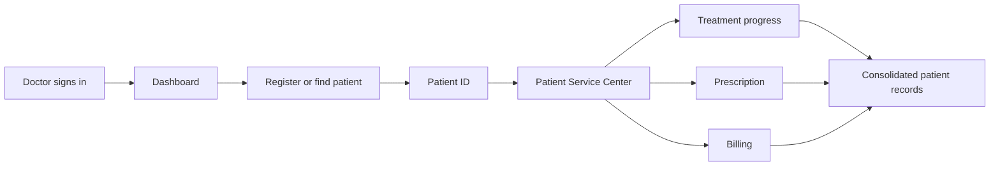

The browser sends JSON requests to Express. Express checks the session, runs MySQL queries and returns the requested data. Account-owned records are associated with `user_id`; clinical records use `patient_id` to associate them with the selected patient.

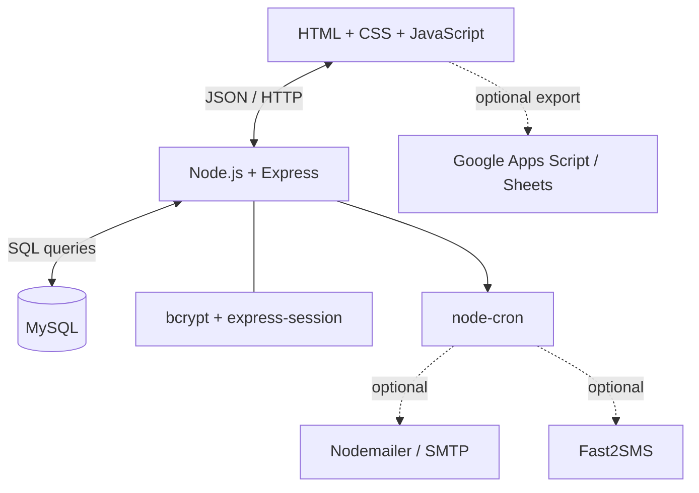

## 🛠 Technology choices

| Layer | Technology | Role |
| :--- | :--- | :--- |
| Interface | HTML5 · CSS3 | Forms, navigation, dashboard cards and tables |
| Browser logic | JavaScript | Fetch requests, validation, search and balance calculations |
| Backend | Node.js · Express 4 | Static pages and JSON API routes |
| Database | MySQL · mysql2 | Persistent relational data and parameterized queries |
| Accounts | bcrypt · express-session | Password hashing and login sessions |
| Reminders | node-cron · Nodemailer | Scheduled checks and optional email delivery |
| Integrations | Fast2SMS · Google Apps Script | Optional SMS and spreadsheet export |

## 📁 Project structure

```text
dentist-projectt/
├── README.md                  # Project showcase and quick start
├── package.json               # Dependencies and start command
├── package-lock.json          # Locked dependency versions
├── .env.example               # Configuration template; no credentials
├── server.js                  # Express API, sessions and reminder scheduler
├── notification-config.js     # Reads optional messaging settings from environment
├── database_setup.sql         # Fresh database schema
├── migrate.sql                # Compatibility migration for older databases
├── login.html                 # Login and account registration
├── index.html                 # Dashboard
├── add-patient.html            # Patient registration
├── search-patient.html         # Patient search
├── edit-patient.html           # Patient and clinical record editing
├── patient-service.html        # Treatment, prescription and billing tabs
├── patients-records.html       # Consolidated records
├── script.js                  # Shared browser-side functions
├── style.css                  # Application styling
├── assets/
│   ├── project-header.svg      # README artwork
│   └── screenshots/            # Actual application captures
└── docs/
    ├── SETUP.md                # Configuration and troubleshooting
    ├── PROJECT_GUIDE.md        # Modules, database and presentation walkthrough
    └── code-notes/             # Earlier explanatory notes
```

## 🎓 Project demonstration

1. **Create an account** and explain session-based access.
2. **Register a patient** and note the generated patient ID.
3. **Find that patient** in the Patient Service Center.
4. **Add treatment progress**, a prescription and a payment.
5. **Open Patient Records** to review the combined information.
6. **Return to the dashboard** to show updated counts, then log out.

For a module-by-module explanation and verification notes, read the **[Project Guide](docs/PROJECT_GUIDE.md)**. For installation help, read the **[Setup Guide](docs/SETUP.md)**.

---

<div align="center">

**Developed as a college project by [@yugsuthar208](https://github.com/yugsuthar208)**

<sub>Patient management · Treatment tracking · Prescriptions · Billing</sub>

</div>
